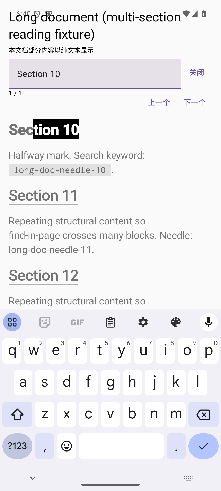
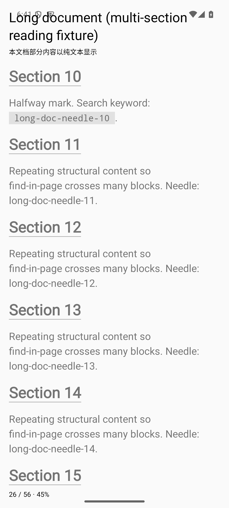
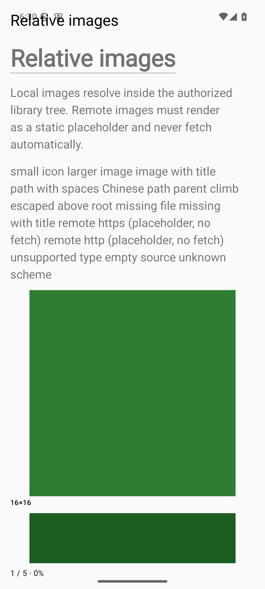
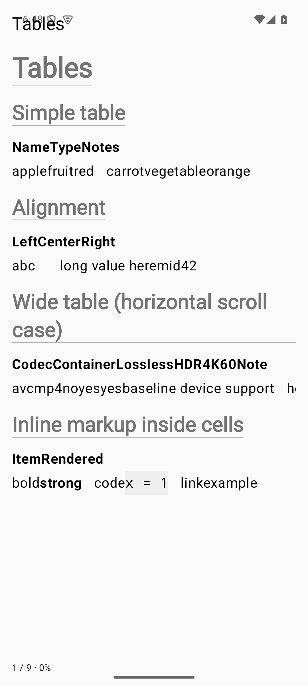

# Leaflet

English | [中文](README.zh.md)


A local-first Android reader for Markdown and plain-text document libraries, designed with E-Ink as a first-class platform.

Leaflet treats folders as libraries: choose a local folder, keep its original structure, and read Markdown and TXT files directly. It targets AI-generated documents, technical notes, research material, and local text collections. It does not require importing files as books, creating an account, or using cloud services.

This is an Android reader project, unrelated to the JavaScript mapping library with the same name.

### Current status

**M1 E-Ink MVP — Alpha candidate (unsigned and unreleased).** The Android project is in place. Both flavors build and install; the Library → Browse → Read → Restore Position flow works. Current evidence (2026-09-29): the deduplicated JVM suite passes 296 tests; the Full flavor passes its 85-test app suite (3 assumption-guarded persistence tests skipped without their seed phase), the Eink flavor passes its 75-test suite plus the 27 new interaction/resource/image tests, and storage passes 17 and Markdown 5. The R2-07 snapshot was 12 production-page tests per flavor and 240 JVM tests. Real-device E-Ink ghosting and refresh have not been verified, and the project license, formal application ID, signing, and distribution channel remain owner decisions.

- [Requirements migration map](docs/product/initial-requirements-map.md): where initialization requirements moved, their current documents, and deferred scope.
- [M0 / M1 implementation plan](docs/plans/M0-M1-implementation-plan.md): T00–T13 tasks, dependencies, acceptance criteria, and agent handoff template. This is a PLANNED snapshot; current progress is recorded in REQ statuses and the [R2 stabilization plan](docs/plans/round-2-stabilization-plan.md).
- [Library browse and removal plan](docs/plans/library-browse-and-remove-plan.md): one-level browse, empty-directory indexing, and long-press Library removal are implemented.
- [AGENTS.md](AGENTS.md): rules that coding agents must read before starting work.
- [Alpha acceptance verdict](docs/plans/round-2-acceptance-verdict.md): mapping of each AC to PASS / PARTIAL / NOT_RUN, test counts, commands, and unverified items.
- [R3 delivery reports](docs/plans/remaining-mvp-tasks.md): R3-05 page interaction, R3-06 links/images, R3-07 large documents/search, and the R3-08 software candidate evidence; R3-09/R3-10 stay blocked on hardware and owner decisions.






### MVP capabilities (implemented; unsigned Alpha candidate)

The following capabilities are implemented and covered by the R2-07 production walkthrough and both flavors' page tests. Real-device E-Ink ghosting and refresh remain unverified; see the acceptance verdict.

- Multiple libraries with persistent Android Storage Access Framework (SAF) permission, folder browsing, and manual refresh.
- Reading `.md`, `.markdown`, and `.txt`; table of contents (TOC), in-document search, reading position, and recent documents.
- Basic font, font size, line spacing, and page-margin settings; tables, code blocks, relative local links, and images.
- High-contrast E-Ink display, animation-free page turns, tap zones, and continuous scrolling; basic Standard display mode.

Original files are the single source of truth. The app database stores auxiliary indexes, reading state, and settings. Removing a library reference or clearing app data must not delete source files. Reading is offline by default and remote images are not loaded automatically.

The MVP does not include an editor, accounts, cloud sync, AI Chat/RAG, PDF/EPUB, OCR, plugins, or library-wide full-text search.

### Two distribution flavors

Distribution flavor and runtime display mode are separate dimensions.

| Planned flavor | Purpose | M0/M1 default mode | Release plan |
| --- | --- | --- | --- |
| Leaflet Full (`full`) | General Android edition | Standard by default; E-Ink can be selected | Keep buildable; formal release is deferred |
| Leaflet E-Ink (`eink`) | Lean reader for E-Ink devices | E-Ink by default; retain basic Standard switching to verify the policy architecture | Primary development and release target |

Both flavors share the Reader core. Differences are expressed through dependencies, resources, capability configuration, and platform adapters; there are not two Reader implementations. The MVP does not integrate the Onyx SDK. Hardware refresh is controlled by the device system, so the app does not promise specific partial-refresh behavior.

### Technical direction and project layout

Kotlin, Gradle Kotlin DSL, AndroidX, Coroutines/StateFlow, Room (from T04), DataStore, and SAF. The UI shell uses Compose. The reading area uses native Markwon Spanned rendering (introduced in T06 and connected to the production path in R2-03 through one `MarkdownRenderer` seam), with Compose item binding. The toolchain is frozen at Gradle Wrapper 8.13, AGP 8.13.2, Kotlin 2.0.21, JDK 17 for the daemon, compileSdk/targetSdk 35, and minSdk 29. Measured AndroidX versions are in `docs/development/build.md`.

```text
Leaflet/
├── AGENTS.md
├── README.md
├── CHANGELOG.md
├── THIRD_PARTY_LICENSES.md
├── settings.gradle.kts / build.gradle.kts / gradle.properties
├── gradle/
│   ├── libs.versions.toml
│   └── wrapper/
├── app/            # Compose shell, navigation, ViewModel, manual DI, flavor configuration
├── core/
│   ├── model/      # Library, Document, ReadingPosition, DisplayMode
│   ├── storage/    # Room + SAF + DataStore implementation (T04/R2-04/R2-05)
│   ├── markdown/   # Single-seam Markwon parsing pipeline (T06/R2-01/R2-02)
│   ├── reader/     # Session, position, page turns, search, and gesture arbitration (T06–T11/R2)
│   └── eink/       # DisplayProfile, MotionPolicy, Capabilities, EInkController
├── docs/development/   # build / testing / release
└── .github/workflows/ci.yml
```

Module responsibilities, requirement files, and the ADR workflow are documented in the implementation plan.

### Build and verification

```bash
./gradlew :app:assembleFullDebug :app:assembleEinkDebug
./gradlew test lint ktlintCheck
./gradlew :app:connectedFullDebugAndroidTest
./gradlew :app:connectedEinkDebugAndroidTest
./gradlew :app:assembleFullRelease :app:assembleEinkRelease
```

Both flavors' debug/release APKs, JVM unit tests (240 deduplicated), lint, `ktlintCheck`, page tests (12 per flavor), and module device tests (storage 16 + Markdown 5) were verified on 2026-09-18; see the acceptance verdict. Real-device E-Ink ghosting and refresh remain pending. Command details and measured tool versions are in `docs/development/build.md`.

Ghosting, refresh, and continuous page-turn experience must be checked on real E-Ink hardware. Android Emulator cannot replace that verification.

### Roadmap

| Milestone | Goal |
| --- | --- |
| M0 Foundation | Project, rules, both flavors, and the basic folder → reader → position-restoration flow |
| M1 E-Ink MVP | Full MVP capabilities, performance and device verification, and an E-Ink Alpha release candidate |
| M2 Reader Quality | Improve large documents, tables, code, images, TOC, and search |
| M3 Full Android Edition | Complete the Standard experience and release the Full edition |
| M4 Search & Library Scale | Library-wide search and large-library improvements |
| M5 Advanced E-Ink Integration | Isolated vendor SDK adapters and refresh control |

M2 improvements do not replace the basic table, code-block, and relative-resource support required in M1. Later milestones are direction, not delivery-date commitments.

### Contributing

Read [AGENTS.md](AGENTS.md) and the implementation plan before taking a task. A clear new feature needs a corresponding REQ; an important technical decision needs an ADR. Requirements and architecture documents were established in T01.

Keep changes scoped. Do not upgrade dependencies, refactor unrelated modules, or expand product scope as a side task. Report actual verification and unverified items; do not describe planned capabilities as implemented.

### License

The project license has not been decided, and no open-source license is currently provided. Before formal release, the project owner must decide and add `LICENSE` plus an accurate third-party license inventory. Research references do not grant permission to copy their code.

---
