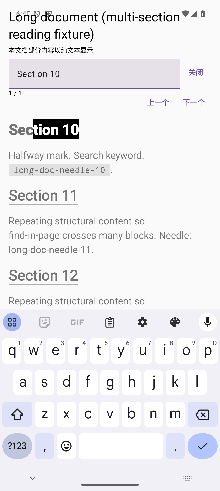
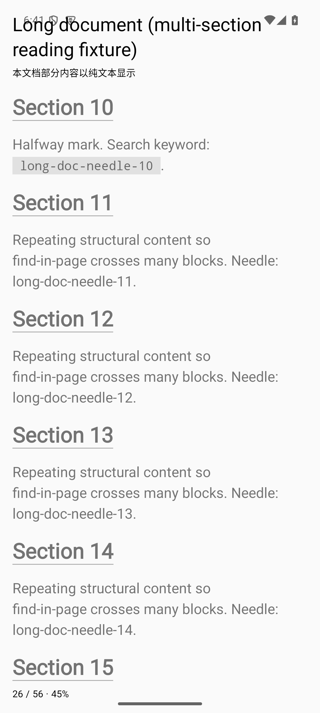
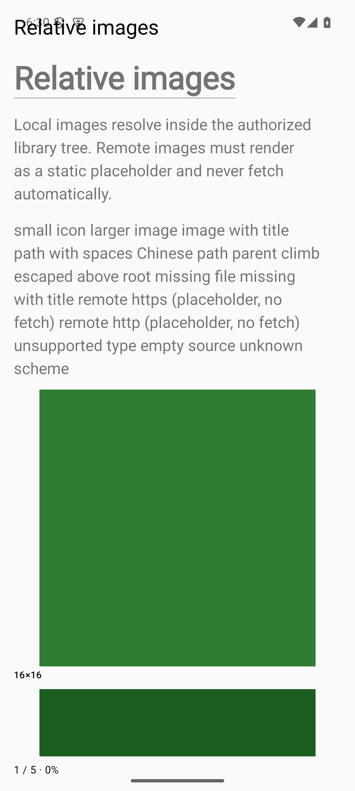
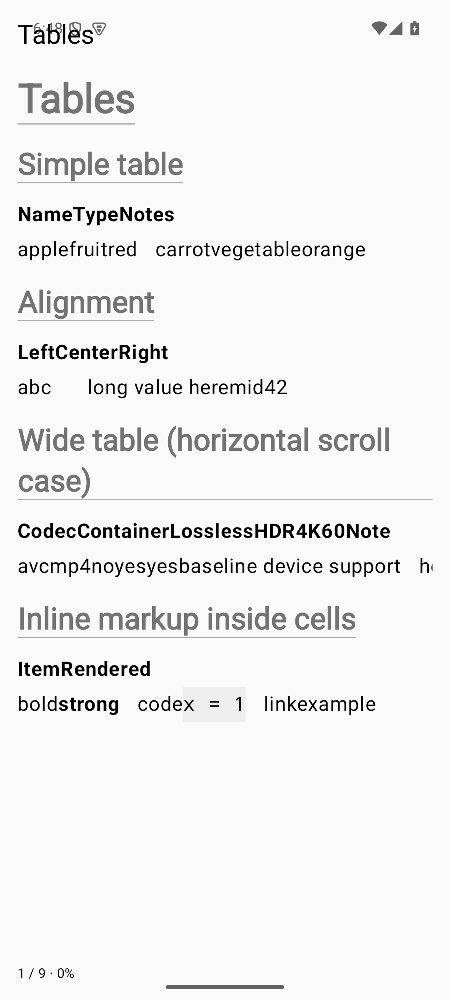

# Leaflet

[English](README.md) | 中文

Leaflet 将目录视为资料库：选择本地目录，保留原始目录结构，直接阅读其中的 Markdown 和 TXT。面向 AI 生成文档、技术笔记、研究资料与本地文本收藏；不要求导入成书籍、注册账号或使用云服务。

这是 Android 阅读器项目，与同名 JavaScript 地图库无关。

## 当前状态

**M1 E-Ink MVP — Alpha 候选（未签名、未发布）。** Android 工程已存在：双 flavor 均可构建安装，资料库 → 浏览 → 阅读 → 位置恢复闭环可用。当前证据（2026-09-29）：JVM 去重 296 用例全绿；Full flavor 的 app 设备套件 85 项通过（3 项两阶段持久化用例在缺少种子阶段时按假设跳过），Eink flavor 的 75 项套件加新增 27 项交互/资源/图片用例通过；storage 17 项、Markdown 5 项。R2-07 快照为每 flavor 12 项生产页面用例、JVM 240 项。E-Ink 实机残影/刷新无设备验证；许可证、正式 ID、签名与分发渠道待项目所有者决定。

- [需求迁移索引](docs/product/initial-requirements-map.md)：初始化要求的章节去向、现行文档与后置范围。
- [M0 / M1 实施计划](docs/plans/M0-M1-implementation-plan.md)：T00–T13 任务、依赖、验收与 agent 派发模板（PLANNED 快照，实际进度见各 REQ 状态与 [R2 收敛计划](docs/plans/round-2-stabilization-plan.md)）。
- [资料库浏览与移除计划](docs/plans/library-browse-and-remove-plan.zh.md)：逐层浏览、空目录索引和长按移除资料库均已实现。
- [AGENTS.md](AGENTS.md)：编码 agent 开始工作前必须读取的规约。
- [Alpha 验收 verdict](docs/plans/round-2-acceptance-verdict.md)：每条 AC 的 PASS / PARTIAL / NOT_RUN 映射、用例数、命令与未验证项。
- [R3 交付报告](docs/plans/remaining-mvp-tasks.zh.md)：R3-05 翻页交互、R3-06 链接/图片、R3-07 大文档/搜索，以及 R3-08 软件候选证据；R3-09/R3-10 仍因缺少真机与所有者决定而阻塞。






## MVP 能力（已实现，Alpha 候选未签名）

以下均为已实现能力（R2-07 生产走查 + 双 flavor 页测覆盖；E-Ink 实机残影/刷新除外，见验收 verdict）：

- 多目录资料库，使用 Android Storage Access Framework（SAF）持久授权，支持目录浏览与手动刷新。
- 阅读 `.md`、`.markdown`、`.txt`，提供目录大纲（TOC）、文内搜索、阅读位置与最近阅读。
- 基础字体、字号、行距、页边距设置，以及表格、代码块、本地相对链接和图片。
- E-Ink 高对比显示、无动画翻页、点击区域操作与连续滚动；基础 Standard 显示模式。

原始文件是唯一事实来源。应用数据库只保存索引、阅读状态与设置等辅助数据；移除资料库引用或清除应用数据不得删除原文。默认阅读路径离线，不自动加载远程图片。

MVP 不包含编辑器、账号、云同步、AI Chat/RAG、PDF/EPUB、OCR、插件或全库全文搜索。

## 两个发行版本

发行版本（build flavor）与运行时显示模式（runtime mode）相互独立。

| 计划版本 | 定位 | M0/M1 显示模式 | 发布安排 |
| --- | --- | --- | --- |
| Leaflet Full (`full`) | 普通 Android 完整版 | 默认 Standard，可切换 E-Ink | 保持可构建，正式发布后置 |
| Leaflet E-Ink (`eink`) | 精简的墨水屏阅读版本 | 默认 E-Ink，保留基础 Standard 切换以验证策略架构 | 首要开发与发布目标 |

两个版本共享阅读核心，通过依赖、资源、能力配置和平台适配体现差异，不维护两套 Reader。MVP 暂不集成 Onyx SDK，硬件刷新由设备系统控制；不能据此承诺特定设备的局部刷新效果。

## 技术方向与项目结构

Kotlin、Gradle Kotlin DSL、AndroidX、Coroutines/StateFlow、Room（T04 起）、DataStore 与 SAF。界面外壳为 Compose，阅读区为 Markwon 原生 Spanned（T06 引入、R2-03 接入生产路径，单缝合 `MarkdownRenderer`）+ Compose 条目绑定。工具链冻结：Gradle Wrapper 8.13、AGP 8.13.2、Kotlin 2.0.21、JDK 17 跑 daemon、compileSdk/targetSdk 35、minSdk 29（AndroidX 四件套见 `docs/development/build.md` 的 T02 实测版本）。

当前目录：

```text
Leaflet/
├── AGENTS.md
├── README.md
├── CHANGELOG.md
├── THIRD_PARTY_LICENSES.md
├── settings.gradle.kts / build.gradle.kts / gradle.properties
├── gradle/
│   ├── libs.versions.toml
│   └── wrapper/
├── app/            # Compose Shell、导航、ViewModel、manual DI、flavor 配置
├── core/
│   ├── model/      # Library、Document、ReadingPosition、DisplayMode
│   ├── storage/    # Room + SAF + DataStore 实现（T04/R2-04/R2-05 落地）
│   ├── markdown/   # Markwon 单缝合解析管线（T06/R2-01/R2-02 落地）
│   ├── reader/     # 会话/位置/翻页/搜索/手势仲裁（T06–T11/R2 落地）
│   └── eink/       # DisplayProfile、MotionPolicy、Capabilities、EInkController
├── docs/development/   # build / testing / release
└── .github/workflows/ci.yml
```

模块职责、需求文件及 ADR 工作流见实施计划。

## 构建与验证

```bash
./gradlew :app:assembleFullDebug :app:assembleEinkDebug
./gradlew test lint ktlintCheck
./gradlew :app:connectedFullDebugAndroidTest
./gradlew :app:connectedEinkDebugAndroidTest
./gradlew :app:assembleFullRelease :app:assembleEinkRelease
```

双 flavor debug/release APK、JVM 单测（去重 240）、lint、`ktlintCheck`、双 flavor 页测（各 12）及模块设备测（storage 16 + markdown 5）均已验证通过（2026-09-18，见验收 verdict）；E-Ink 实机残影/刷新待设备。命令细节与版本实测证据见 `docs/development/build.md`。

E-Ink 残影、刷新和连续翻页体验必须在实机验证，Android Emulator 不能代替这一验收。

## Roadmap

| 里程碑 | 目标 |
| --- | --- |
| M0 Foundation | 工程、规约、双 flavor，以及目录到阅读和位置恢复的基础闭环 |
| M1 E-Ink MVP | 完整 MVP 能力、性能与实机验证、E-Ink Alpha 发布候选 |
| M2 Reader Quality | 大文档、表格、代码、图片、TOC 与搜索质量优化 |
| M3 Full Android Edition | 完善 Standard 体验并发布 Full 版 |
| M4 Search & Library Scale | 全库搜索与大规模资料库优化 |
| M5 Advanced E-Ink Integration | 隔离的厂商 SDK 适配与刷新控制 |

M2 的优化不替代 M1 已要求的基础表格、代码块与相对资源支持。后续里程碑是方向，不是交付日期承诺。

## 参与开发

先读取 [AGENTS.md](AGENTS.md) 与实施计划，再领取一个依赖已满足的任务。明显新功能需有对应 REQ，重要技术决策需记录 ADR；需求与架构文档由 T01 建立。

变更应保持范围最小，不顺带升级依赖、重构无关模块或扩展产品范围。交付时报告实际验证结果和未验证项，不将计划能力写成已实现特性。

## License

项目许可证尚未确定，当前未提供开源许可声明。正式发布前需由项目所有者决定，并补充 `LICENSE` 与实际依赖的第三方许可清单。研究参考项目不代表获得复制其代码的许可。
