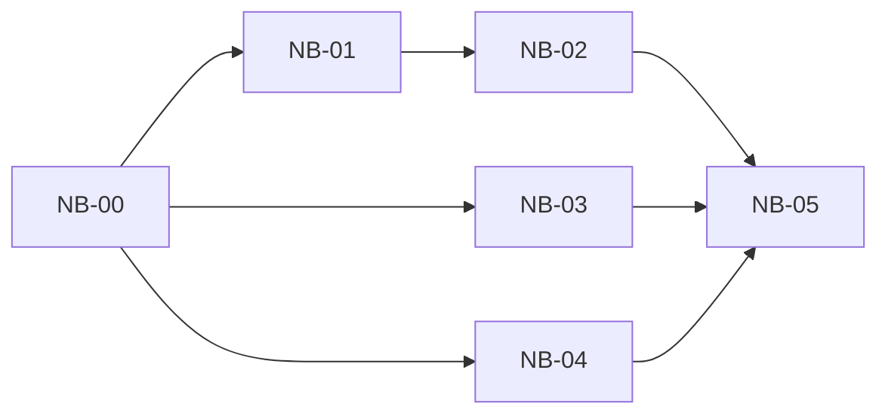

# Library Navigation UX Tasks

English | [中文](library-navigation-ux-tasks.zh.md)

Date: 2026-10-01
Status: DELIVERED — NB-00–NB-05 implemented and software-verified; device and hardware checks NOT_RUN. See [delivery](library-navigation-ux-delivery.md).
Plan: [Library Navigation UX Plan](library-navigation-ux-plan.md).
Parent: [UI/UX Optimization Tasks](ui-ux-optimization-tasks.md), UX-05.
Requirements: [REQ-0001](../requirements/REQ-0001-folder-library.md), [REQ-0004](../requirements/REQ-0004-display-profiles.md); the READY scoped feature requirement is an NB-00 deliverable.

## Order and ownership

| ID | Task | Dependencies | Primary ownership | Deliverable |
| --- | --- | --- | --- | --- |
| NB-00 | Requirements and prerequisite gate | Existing UX-01/02/04 evidence | Paired requirement/plan documents | READY scoped requirement, baseline, and explicit UI readiness decision |
| NB-01 | Ancestor mapping and guarded state transition | NB-00 requirement gate | `BrowseLevel.kt` or a small adjacent helper, `LibraryViewModel.kt`, JVM tests | Pure path mapping and validated ancestor navigation |
| NB-02 | Breadcrumb controls | NB-01; UX-01/04 ready, including UX-02 dependency | `LibraryScreens.kt`, local strings, browse page tests | Tappable root/ancestors, identifiable current directory, reachable long path |
| NB-03 | Stable scan-status region | NB-00; same UI prerequisites as NB-02 | `LibraryScreens.kt`, status strings, browse page tests | State updates preserve list geometry and scroll anchor |
| NB-04 | Row targets and type cues | NB-00; same UI prerequisites as NB-02 | `LibraryScreens.kt`, local icons/strings, browse page tests | At least 48 dp clickable rows with accessible folder/document distinction |
| NB-05 | Integration acceptance and handoff | NB-02, NB-03, NB-04 | Focused tests, paired delivery report, CHANGELOG | Both flavor gates, measured page evidence, and clear hardware omissions |

NB-02/03/04 have shared-file ownership: implement or integrate NB-02 → NB-03 → NB-04 serially. Logical independence does not permit simultaneous edits to `LibraryScreens.kt`, the same string resources, or the same test harness. Finish and hand off one card before starting another.

**Status (2026-10-01): DELIVERED — SOFTWARE VERIFIED, DEVICE PENDING.** NB-00 closed the requirement gate with [REQ-0012](../requirements/REQ-0012-library-navigation.md) (`READY`) plus the plan's readiness record and its documented dependency narrowing. NB-01–NB-04 are implemented: validated ancestor navigation, the breadcrumb row, the reserved scan-status region, and ≥48 dp typed rows, with JVM regressions and page regressions written against the production `LibraryBrowseScreen`. NB-05 ran the JVM/lint gates and both debug builds. Every instrumented page case is NOT_RUN (no device or emulator attached), so no hardware, E-Ink, or TalkBack claim is made. Files, commands, counts, and omissions are in [Library Navigation UX delivery](library-navigation-ux-delivery.md).

## NB-00 — Requirements and prerequisite gate

- **Scope:** Map plan AC-N1–N6 to the current requirements. Create/refine a paired scoped requirement and reach READY before any new feature implementation; do not declare the entire `IN_PROGRESS` REQ-0001 complete. Record the current working-tree baseline so previous uncommitted reader/review work is preserved.
- **Prerequisites:** Confirm UX-01 safe areas, UX-02 display policy, and UX-04 Library/home readiness with their deliverables and actual page evidence. The present source review is not proof they passed. Record unmet packages and keep UI tasks gated; any dependency narrowing needs an explicit rationale in the parent plan.
- **Acceptance:** Document each prerequisite as verified, missing, or not run with evidence; specify baseline paths, the long-path/font-scale policy, and which UI tasks may start. The feature requirement is READY and every acceptance condition has an owner/task mapping.
- **Verification:** Check bilingual structure, references, and links; baseline walkthrough only when a device is available. Do not modify product code as part of this card.
- **Stop:** The requirement and readiness matrix are reviewable. Missing external prerequisites are reported as separate tasks; this card does not implement all of UX-01/02/04.

## NB-01 — Ancestor mapping and guarded state transition

- **Scope:** Generate root/current/ancestor segments from the existing relative prefix. Add one app-level ViewModel action for selecting a generated ancestor in the current Library. Keep `enterDirectory`, `leaveDirectory`, `browseLevel`, directory ordering, and storage contracts intact.
- **Path contract:** Root is `""`; targets are exact path prefixes at segment boundaries. A stale Library request, sibling target, tree escape, or invalid externally supplied prefix is ignored. The current target is a no-op. Do not decode content URIs or reinterpret literal percent characters.
- **Acceptance:** Root, a three-level path, Chinese/spaced/mixed-case names, empty directories, `a` versus `ab`, and invalid/stale targets are covered. Ancestor selection followed by Back lands on the correct parent; changing Libraries starts at the new root. No file content or SAF query is needed for a breadcrumb transition.
- **Verification:** Focused pure mapping and real ViewModel transition tests using existing JUnit/Coroutines seams, including an unchanged-state assertion for rejected requests. Existing `BrowseLevelTest` and Library removal safety remain green.
- **Stop:** The guarded state transition passes without UI changes, a migration, or a new framework. Hand off the segment/target contract to NB-02.

## NB-02 — Breadcrumb controls

- **Scope:** Replace the plain `state.prefix` label with the Library root and generated segments. Wire taps to NB-01's validated action. Keep the current segment visually and semantically identifiable; navigation to another prefix starts that list at the top, while the current segment leaves state/scroll unchanged.
- **Layout:** Keep all ancestors reachable through a bounded-height horizontally scrollable row. Support a three-level path, ten levels, long names, portrait/landscape, and 200% system font scale. New clickable segments measure at least 48 dp; full names remain accessible even if visual labels are shortened.
- **Acceptance:** From `Docs/Notes/2026`, tapping `Docs` shows that directory's direct children, tapping the root shows root entries, nested Back moves one level, and root Back exits once. File taps still hand the original document ID to the Reader. Empty directories show their existing empty state.
- **Verification:** Test the production browse UI with real navigation callbacks/ViewModel transitions and controlled metadata, not a test-only replica. Measure segment targets and path reachability in both runtime display modes; use static E-Ink interactions. New strings have English/Simplified Chinese resources.
- **Stop:** AC-N1/N2/N3 pass in the UI. Do not add folder-history persistence or refactor the home/Recent screen.

## NB-03 — Stable scan-status region

- **Scope:** Replace state-specific inserted text/button/gap combinations with one reserved status region. Retain Refresh, Cancel, Retry, and recoverable failure/cancellation information, including existing scanner throttling and previous-index retention.
- **Layout:** Keep the region's outer size stable at a fixed available width/font scale. Accommodate wrapped labels and action targets; expose overflow path/error details without expanding the outer region or hiding the failure. Size decisions must pass small-screen and 200% font-scale checks, not rely on a guessed universal height.
- **Acceptance:** With identical indexed rows and prefix, drive `IDLE → SCANNING → CANCELLING → CANCELLED`, `SCANNING → SUCCEEDED`, and `SCANNING → FAILED → Retry`. List viewport top/height and first visible item key/offset do not change beyond one physical pixel. Clicking controls still calls the corresponding production action.
- **Verification:** Use controlled progress with the production state-binding UI; measure real list bounds/scroll state before and after each transition, including a long path/error, an empty folder, and a scrolled populated folder. Test document-index changes and rotation separately rather than treating them as status jitter.
- **Stop:** AC-N4/N6 pass. Do not alter scanning algorithms, cancellation/index-write semantics, or add animated progress.

## NB-04 — Row targets and type cues

- **Scope:** Enforce at least 48 dp on the actual clickable file/folder row; use minimum height with room for wrapped names. Add consistent folder/document cues and readable MD/TXT labels, reusing existing assets or small local vectors.
- **Accessibility:** Keep the entire row actionable; merge decorative icon semantics to avoid duplicate announcements. Convey type and name without relying only on color. Existing E-Ink indication/motion policy applies, and the current file callback receives the same ID.
- **Acceptance:** Measure clickable semantics bounds for folders and MD/Markdown/TXT files. At 200% font scale, long English/Chinese names wrap without truncating controls or forcing a fixed row height. Empty folders remain selectable; directory-before-file order and mixed-case sorting are unchanged.
- **Verification:** Production page assertions for bounds, click behavior, and semantics; run existing ordering/removal regressions. Test Standard/E-Ink runtime modes and retain screenshots. Manual TalkBack/device checks are recorded separately when available.
- **Stop:** AC-N5/N6 pass. Do not introduce a global design system, icon dependency, sorting modes, or Library-wide search.

## NB-05 — Integration acceptance and handoff

- **Scope:** Integrate NB-02/03/04 serially and verify the production browse flow in both `full` and `eink`. Recheck source/config identity if using an isolated build copy, and preserve unrelated uncommitted changes.
- **Matrix:** Cover no Libraries, one Library, two Libraries with matching folder names, root, three/ten-level folders, empty directories, mixed file/folder rows, long paths, 200% font scale, portrait/landscape, all scan states, failed/cancelled scans, revoked access, and a file opening in the Reader. Use unchanged indexed rows for the strict viewport-stability comparison.
- **Gates:** Execute the plan's JDK 17 JVM/lint/ktlint and dual-debug-build commands, then both flavors' focused browsing page tests. Existing read-only scan/removal regressions are required. Record test counts and screenshots; label real E-Ink/TalkBack as NOT_RUN if unavailable, rather than turning emulator evidence into a hardware claim.
- **Deliverables:** Update the parent UX-05 status, the scoped requirement's software acceptance evidence, paired CHANGELOG, and a paired delivery report listing files, checks, failures/corrections, preserved contracts, and omissions. Keep hardware-dependent completion separate.
- **Stop:** AC-N1–N6 have software evidence, both flavors pass, retained evidence is explicitly located, and all temporary data is cleaned. No commit, release, vendor SDK integration, or automatic start of another UX package.

## Handoff rules

Each card names its owned files and actual verification results, and updates its paired task/requirement records. Product implementation starts only when the user assigns an implementation task and the applicable requirement gate is met. This task-splitting request stops after the paired documents and their links are checked.

No temporary data is needed for this planning change. Future test fixtures, logs, caches, and captures belong only under the cwd or `/tmp`; remove them when finished and record any retained evidence by absolute path.
