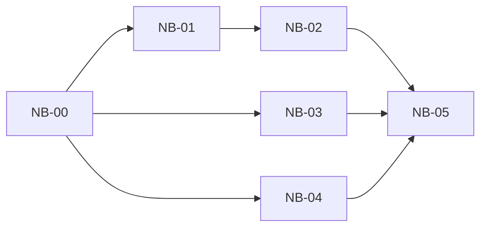

# 资料库导航体验任务

[English](library-navigation-ux-tasks.md) | 中文

日期：2026-10-01
状态：DELIVERED — NB-00–NB-05 已实现并通过软件验证；设备与硬件检查为 NOT_RUN。见[交付报告](library-navigation-ux-delivery.zh.md)。
计划：[资料库导航体验计划](library-navigation-ux-plan.md)。
上级：[UI/UX 优化任务](ui-ux-optimization-tasks.md)，UX-05。
需求：[REQ-0001](../requirements/REQ-0001-folder-library.md)、[REQ-0004](../requirements/REQ-0004-display-profiles.md)；READY 的局部功能需求是 NB-00 交付物。

## 顺序与所有权

| ID | 任务 | 依赖 | 主要文件所有权 | 交付物 |
| --- | --- | --- | --- | --- |
| NB-00 | 需求与前置门禁 | 既有 UX-01/02/04 证据 | 双语需求和计划文档 | READY 局部需求、基线、明确的 UI 就绪决定 |
| NB-01 | 祖先映射与带校验的状态转换 | NB-00 需求门禁 | `BrowseLevel.kt` 或小型相邻辅助文件、`LibraryViewModel.kt`、JVM 测试 | 纯路径映射及校验后的祖先导航 |
| NB-02 | 面包屑控件 | NB-01；UX-01/04 就绪，包括 UX-02 依赖 | `LibraryScreens.kt`、局部字符串、浏览页面测试 | 可点击的根节点和祖先、可辨的当前目录、可达的长路径 |
| NB-03 | 稳定扫描状态区域 | NB-00；UI 前置条件与 NB-02 相同 | `LibraryScreens.kt`、状态字符串、浏览页面测试 | 状态更新保留列表几何与滚动锚点 |
| NB-04 | 行触控目标与类型提示 | NB-00；UI 前置条件与 NB-02 相同 | `LibraryScreens.kt`、局部图标和字符串、浏览页面测试 | 至少 48 dp 的可点击行及可访问的文件夹/文档区分 |
| NB-05 | 集成验收与交接 | NB-02、NB-03、NB-04 | 聚焦测试、双语交付报告、CHANGELOG | 两个发行版门禁、实测页面证据、明确的硬件遗漏项 |

NB-02/03/04 存在共享文件所有权：按 NB-02 → NB-03 → NB-04 串行实现或集成。逻辑独立不代表可以同时修改 `LibraryScreens.kt`、同一字符串资源或同一测试接缝。完成并交接一张任务卡后再开始下一张。

**状态（2026-10-01）：DELIVERED — 软件已验证，设备待补。** NB-00 以 [REQ-0012](../requirements/REQ-0012-library-navigation.zh.md)（`READY`）、计划的就绪记录及其已记录的依赖收窄关闭了需求门禁。NB-01–NB-04 已实现：带校验的祖先导航、面包屑行、保留的扫描状态区域，以及 ≥48 dp 的类型化行，并针对真实 `LibraryBrowseScreen` 编写了 JVM 回归与页面回归。NB-05 执行了 JVM/lint 门禁与两个 debug 构建。所有插桩页面用例均为 NOT_RUN（无设备/模拟器），因此不作任何硬件、E-Ink 或 TalkBack 结论。文件、命令、计数与遗漏项见[资料库导航体验交付](library-navigation-ux-delivery.zh.md)。

## NB-00 — 需求与前置门禁

- **范围：** 将计划 AC-N1–N6 映射到现有需求。创建或细化双语局部需求，在任何新功能实现前达到 READY；不得宣布整个 `IN_PROGRESS` 的 REQ-0001 已完成。记录当前工作区基线，保留已有未提交的阅读器与代码审查工作。
- **前置条件：** 根据交付物和实际页面证据确认 UX-01 安全区域、UX-02 显示策略、UX-04 资料库首页就绪状态。本次源码审查不是通过证据。记录未完成工作包，继续限制 UI 任务启动；缩减依赖必须在上级计划中明确记录理由。
- **验收：** 每项前置条件明确标为已验证、缺失或未运行，并附证据；明确基线路径、长路径/字号缩放策略及允许启动的 UI 任务。功能需求为 READY，每条验收都有所有者和任务映射。
- **验证：** 检查双语结构、引用和链接；只有设备可用时才做基线走查。本任务不得修改产品代码。
- **停工：** 需求及就绪矩阵可审阅。缺少的外部前置交付作为独立任务报告；本任务不实现整个 UX-01/02/04。

## NB-01 — 祖先映射与带校验的状态转换

- **范围：** 从现有相对前缀生成根节点、当前位置和祖先分段。增加一个应用层 ViewModel 操作，在当前资料库选择生成的祖先目标。保留 `enterDirectory`、`leaveDirectory`、`browseLevel`、目录排序和存储契约。
- **路径契约：** 根目录为 `""`；目标必须位于完整路径段边界。过期资料库请求、兄弟目录目标、越出树范围或非法外部前缀均忽略。当前目标不做操作。不解码 content URI，不重新解释字面百分号。
- **验收：** 覆盖根目录、三层路径、中文/空格/大小写名称、空目录、`a` 与 `ab`、非法及过期目标。选择祖先后返回落在正确父目录；切换资料库从新根目录开始。面包屑转换不需要读取文件内容或查询 SAF。
- **验证：** 使用既有 JUnit/Coroutines 接缝执行聚焦纯映射和真实 ViewModel 转换测试，包括拒绝请求后状态不变的断言。现有 `BrowseLevelTest` 和资料库移除安全测试保持通过。
- **停工：** 带校验的状态转换通过，不包含 UI 改动、迁移或新框架。将分段与目标契约交接给 NB-02。

## NB-02 — 面包屑控件

- **范围：** 用资料库根节点和生成的分段替换纯文字 `state.prefix`。点击连接到 NB-01 校验后的操作。当前位置具有视觉及语义标识；导航到其他前缀时列表回到顶部，点击当前位置时状态和滚动不变。
- **布局：** 所有祖先通过高度受限的横向滚动行可达。支持三层路径、十层路径、长名称、横竖屏及 200% 系统字号。新增可点击分段实测至少 48 dp；即使视觉标签缩短，完整名称仍可访问。
- **验收：** 在 `Docs/Notes/2026` 点击 `Docs` 显示该目录直接子项，点击根节点显示根目录条目；嵌套返回向上一层，根目录返回退出一次。文件点击仍向 Reader 传递原始文档 ID。空目录显示现有空状态。
- **验证：** 对生产浏览 UI 使用真实导航回调/ViewModel 转换和可控元数据，不复制测试专用 UI。在两个运行显示模式下测量分段触控目标 (touch target) 和路径可达性，E-Ink 使用静态交互。新增字符串有英文/简体中文资源。
- **停工：** AC-N1/N2/N3 在 UI 中通过。不增加目录历史持久化、不重构首页和最近阅读。

## NB-03 — 稳定扫描状态区域

- **范围：** 用一个预留状态区域替换按状态插入的文字、按钮、间隔组合。保留刷新、取消、重试及可恢复失败/取消信息，包括既有扫描节流和上次索引保留行为。
- **布局：** 在固定可用宽度/字号缩放下，区域外层尺寸保持稳定。容纳换行标签和操作触控目标；溢出的路径/错误详情仍可获取，不扩张外层区域、不隐藏失败。尺寸决策须通过小屏和 200% 字号检查，不能依赖猜测的通用高度。
- **验收：** 在索引条目和前缀相同时，驱动 `IDLE → SCANNING → CANCELLING → CANCELLED`、`SCANNING → SUCCEEDED`、`SCANNING → FAILED → Retry`。列表视口顶部、高度和首个可见条目键/偏移变化不超过一个物理像素。点击控件仍调用对应生产操作。
- **验证：** 用可控进度驱动生产状态绑定 UI，逐次测量状态转换前后真实列表边界/滚动状态，覆盖长路径/错误、空目录和已滚动的非空目录。文档索引变化和旋转单独验证，不当作状态抖动。
- **停工：** AC-N4/N6 通过。不改变扫描算法、取消/索引写入语义，不增加动画进度。

## NB-04 — 行触控目标与类型提示

- **范围：** 为实际可点击文件/文件夹行设置至少 48 dp，使用最小高度并允许名称换行。增加统一文件夹/文档提示及可读的 MD/TXT 标签，复用现有资源或小型本地矢量图标。
- **无障碍：** 整行可操作；合并装饰图标语义，避免重复朗读。类型和名称不只通过颜色传达。沿用现有 E-Ink 点击反馈/运动策略；文件回调收到同一个 ID。
- **验收：** 测量文件夹及 MD/Markdown/TXT 文件行的可点击语义边界。200% 字号下，英文/中文长名称换行，不裁剪控件、不强制固定行高。空目录仍可选；目录优先于文件及大小写混合排序不变。
- **验证：** 生产页面断言边界、点击行为和语义；运行既有排序/移除回归。测试 Standard/E-Ink 运行模式并保留截图。手工 TalkBack/设备检查在可用时单独记录。
- **停工：** AC-N5/N6 通过。不引入全局设计系统、图标依赖、排序模式或全资料库搜索。

## NB-05 — 集成验收与交接

- **范围：** 串行集成 NB-02/03/04，在 `full` 和 `eink` 验证生产浏览链路。使用隔离构建副本时复核源码/配置一致性，保留无关未提交改动。
- **矩阵：** 覆盖零资料库、一个资料库、两个含同名目录的资料库、根目录、三/十层文件夹、空目录、文件夹/文件混合行、长路径、200% 字号、横竖屏、全部扫描状态、失败/取消扫描、授权撤销及文件打开 Reader。严格视口稳定性比较使用不变的索引条目。
- **门禁：** 执行计划中的 JDK 17 JVM/lint/ktlint 和双 debug 构建命令，再执行两个发行版的聚焦浏览页面测试。既有只读扫描/移除回归为必需项。记录测试数和截图；E-Ink 实机/TalkBack 不可用时标 NOT_RUN，不把模拟器证据当作硬件结论。
- **交付物：** 更新上级 UX-05 状态、局部需求的软件验收证据、双语 CHANGELOG，以及列出文件、检查、失败/修正、保留契约、遗漏项的双语交付报告。硬件相关完成条件单独记录。
- **停工：** AC-N1–N6 有软件证据，两个发行版通过，保留证据位置明确，全部临时数据已清理。不提交、不发布、不集成厂商 SDK、不自动启动其他 UX 工作包。

## 交接规则

每张任务卡列出所属文件和实际验证结果，并更新双语任务/需求记录。只有用户指派实现任务且适用需求门禁满足后，才开始产品实现。本次任务拆分在双语文档及其链接检查完成后停止。

本次规划不需要临时数据。后续测试样本、日志、缓存和截图只能放在 cwd 或 `/tmp`；完成后删除，并用绝对路径记录保留证据。
